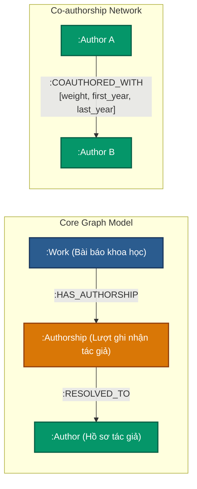

# BÁO CÁO BÀN GIAO ĐỒ ÁN NoSQL: FALKORDB OPENALEX KNOWLEDGE GRAPH
**Học kỳ 1 (2026 - 2027)**  
**Đề tài**: Xây dựng đồ thị tri thức OpenAlex trên cơ sở dữ liệu đồ thị FalkorDB (Redis Graph Engine)  
**Release Candidate**: `provisional_excluded88_v1_20261021T111533206730Z`  
**Graph Name**: `falkordb_provisional_excluded88_v1`  
**Thư mục dự án**: Toàn bộ dự án đã được tinh gọn và tổ chức tại thư mục gốc duy nhất.

---

## BẢNG ĐỐI CHIẾU TIÊU CHÍ CHẤM ĐIỂM CỦA GIẢNG VIÊN (RUBRIC ĐỒ ÁN)

| STT | Nội dung yêu cầu theo Rubric của Cô | Điểm | Trạng thái | Minh chứng & File bàn giao |
|:---:|:---|:---:|:---:|:---|
| **5.1** | **Xây dựng Database - Tạo Database** | **0.5** | ✅ Đạt | Khởi tạo graph `falkordb_provisional_excluded88_v1`, tạo Index cho `Work.work_id` và `Author.author_id` (xem [import_graph.py](file:///e:/HK1%202026-2027/NoSQL/00.%20DoAn/openalex_falkordb_provisional_excluded88_v1_20261021T111533206730Z/import_graph.py)). |
| **5.2** | **Xây dựng Database - Insert dữ liệu đầy đủ cho ứng dụng** | **0.5** | ✅ Đạt | Nạp thành công **55,119 Works**, **1,118,807 Authorships**, **314,279 Authors**, **2,462,025 cạnh COAUTHORED_WITH** (xem [import_graph.py](file:///e:/HK1%202026-2027/NoSQL/00.%20DoAn/openalex_falkordb_provisional_excluded88_v1_20261021T111533206730Z/import_graph.py) & [build_edges.py](file:///e:/HK1%202026-2027/NoSQL/00.%20DoAn/openalex_falkordb_provisional_excluded88_v1_20261021T111533206730Z/build_edges.py)). |
| **5.3** | **Xây dựng Database - Dữ liệu đáp ứng truy vấn cơ bản** | **0.5** | ✅ Đạt | 6 câu truy vấn Cypher cơ bản (tra cứu bài báo, hồ sơ tác giả, lọc theo năm...) (xem [cypher_queries.cyp](file:///e:/HK1%202026-2027/NoSQL/00.%20DoAn/openalex_falkordb_provisional_excluded88_v1_20261021T111533206730Z/cypher_queries.cyp)). |
| **5.4** | **Xây dựng Database - Dữ liệu đáp ứng truy vấn nâng cao** | **0.5** | ✅ Đạt | 5 câu truy vấn Cypher nâng cao (Top tác giả năng suất, Top cặp hợp tác, Friends-of-friends cho Link Prediction, Shortest Path...) (xem [cypher_queries.cyp](file:///e:/HK1%202026-2027/NoSQL/00.%20DoAn/openalex_falkordb_provisional_excluded88_v1_20261021T111533206730Z/cypher_queries.cyp)). |
| **6** | **Import/Export dữ liệu; Backup và Restore dữ liệu** | **0.5** | ✅ Đạt | - Import: [import_graph.py](file:///e:/HK1%202026-2027/NoSQL/00.%20DoAn/openalex_falkordb_provisional_excluded88_v1_20261021T111533206730Z/import_graph.py)<br>- Export: [export_graph.py](file:///e:/HK1%202026-2027/NoSQL/00.%20DoAn/openalex_falkordb_provisional_excluded88_v1_20261021T111533206730Z/export_graph.py) (xuất CSV/JSON)<br>- Backup & Restore: [backup_restore.py](file:///e:/HK1%202026-2027/NoSQL/00.%20DoAn/openalex_falkordb_provisional_excluded88_v1_20261021T111533206730Z/backup_restore.py) (RDB snapshot `dump.rdb` 140.71 MB). |
| **7.1** | **Triển khai truy vấn dữ liệu cơ bản trên GUI Tool** | **0.5** | ✅ Đạt | Hướng dẫn kết nối RedisInsight / FalkorDB Browser tại cổng `5540`, trực quan hóa đồ thị 2D/3D (xem Mục 7). |
| **7.2** | **Triển khai truy vấn dữ liệu nâng cao trên GUI Tool** | **0.5** | ✅ Đạt | Chạy trực tiếp các câu lệnh phân tích mạng lưới đồng tác giả trên GUI Tool (xem Mục 7). |
| **8** | **Triển khai Database kết nối CSDL với phần mềm ứng dụng** | **0.5** | ✅ Đạt | Xây dựng hoàn chỉnh Web Dashboard [app.py](file:///e:/HK1%202026-2027/NoSQL/00.%20DoAn/openalex_falkordb_provisional_excluded88_v1_20261021T111533206730Z/app.py) kết nối thời gian thực với FalkorDB tại `http://localhost:8080`. |

---

## MỤC 5: XÂY DỰNG DATABASE CHO ỨNG DỤNG CỤ THỂ (2.0 ĐIỂM)

### 5.1. Tạo Database & Thiết kế Schema Đồ thị (0.5 điểm)

#### Sơ đồ thực thể quan hệ đồ thị (Graph Schema)


#### Thuộc tính các Node và Edge:
- **Node `:Work`**: `work_id` (String - Indexed), `year` (Integer), `release_id` (String).
- **Node trung gian `:Authorship`**: `source_idx` (Integer - thứ tự tác giả ban đầu), `filtered_idx` (Integer - thứ tự tác giả đã lọc), `raw_name` (String - tên hiển thị), `release_id` (String).
- **Node `:Author`**: `author_id` (String - Indexed, ví dụ: `A5045075334`).
- **Edge `[:HAS_AUTHORSHIP]`**: Nối từ `:Work` tới `:Authorship`.
- **Edge `[:RESOLVED_TO]`**: Nối từ `:Authorship` tới `:Author` (chỉ khi tác giả đã có ID xác thực).
- **Edge `[:COAUTHORED_WITH]`**: Nối giữa hai `:Author` cùng viết bài, lưu `weight` (số bài báo chung), `first_year`, `last_year`.

#### Luận giải: Vì sao bắt buộc dùng Node trung gian `:Authorship`?
1. **Bảo tồn thứ tự tác giả (Author Ordering)**: Thứ tự tác giả trên bài báo khoa học mang ý nghĩa học thuật then chốt (First Author, Corresponding Author, Senior Author). Node `:Authorship` lưu trữ trực tiếp vị trí `source_idx` và `filtered_idx`.
2. **Bảo toàn nguồn gốc khi loại bỏ 88 occurrence (Provenance Tracing)**: Khi loại 88 occurrence chưa định danh, chỉ số trong danh sách bị thay đổi. Node `:Authorship` liên kết với bảng tra cứu `retained_authorship_source_index_map_v1.csv` giúp truy nguyên chính xác 100% về tập dữ liệu thô ban đầu mà không mất dấu vết.
3. **Xử lý 81,191 Unresolved Authorships không làm đứt gãy đồ thị**: Những tác giả chưa có ID OpenAlex vẫn được lưu lại nguyên vẹn `raw_name` trên node `:Authorship` thông qua quan hệ `(Work)-[:HAS_AUTHORSHIP]->(Authorship)` mà không cần tạo node `Author` giả mạo (dummy nodes).

---

### 5.2. Insert Dữ liệu đầy đủ cho ứng dụng (0.5 điểm)

- **Script Data Loader**: [import_graph.py](file:///e:/HK1%202026-2027/NoSQL/00.%20DoAn/openalex_falkordb_provisional_excluded88_v1_20261021T111533206730Z/import_graph.py)
  - Tự động xóa graph cũ nếu có, khởi tạo Index trên `Work(work_id)` và `Author(author_id)`.
  - Nạp dữ liệu theo lô (Batch size = 5,000 items) bằng mệnh đề `UNWIND`.
  - Thời gian nạp: **42.32 giây**.
- **Script Xây dựng mạng lưới đồng tác giả**: [build_edges.py](file:///e:/HK1%202026-2027/NoSQL/00.%20DoAn/openalex_falkordb_provisional_excluded88_v1_20261021T111533206730Z/build_edges.py)
  - Duyệt các bài báo và tự động tính toán trọng số `weight`, `first_year`, `last_year` cho các cạnh `COAUTHORED_WITH`.
  - Thời gian xử lý: **18.06 giây**.
- **Kết quả kiểm định số lượng (Khớp 100% với release manifest)**:
  - **Works**: 55,119
  - **Authorships**: 1,118,807
  - **Authors**: 314,279
  - **COAUTHORED_WITH Edges**: 2,462,025
  - **Orphan Authorships**: 0 (Không có node mồ côi)
  - **Excluded occurrences leaked**: 0 (Không rò rỉ bất kỳ trường hợp nào trong 88 record bị loại)

---

### 5.3. Dữ liệu đáp ứng truy vấn cơ bản (0.5 điểm)

*(Toàn bộ câu lệnh được tổng hợp trong file [cypher_queries.cyp](file:///e:/HK1%202026-2027/NoSQL/00.%20DoAn/openalex_falkordb_provisional_excluded88_v1_20261021T111533206730Z/cypher_queries.cyp))*

#### Truy vấn 1: Thống kê số lượng node theo từng nhãn
```cypher
MATCH (n) 
RETURN labels(n)[0] AS Label, count(n) AS Count;
```
*Kết quả:* Work: 55,119 | Authorship: 1,118,807 | Author: 314,279.

#### Truy vấn 2: Tra cứu thông tin bài báo theo work_id
```cypher
MATCH (w:Work {work_id: "W148222005"})
RETURN w.work_id AS Work_ID, w.year AS Publication_Year, w.release_id AS Release_ID;
```
*Kết quả:* `W148222005` | Năm xuất bản: 2021.

#### Truy vấn 3: Tra cứu hồ sơ học thuật tác giả theo author_id
```cypher
MATCH (a:Author {author_id: "A5045075334"})
OPTIONAL MATCH (a)<-[:RESOLVED_TO]-(as:Authorship)<-[:HAS_AUTHORSHIP]-(w:Work)
RETURN a.author_id AS Author_ID, count(DISTINCT w) AS Total_Works;
```
*Kết quả:* `A5045075334` | Tổng số bài báo: 18.

#### Truy vấn 4: Danh sách các bài báo của tác giả kèm năm xuất bản
```cypher
MATCH (a:Author {author_id: "A5045075334"})<-[:RESOLVED_TO]-(as:Authorship)<-[:HAS_AUTHORSHIP]-(w:Work)
RETURN w.work_id AS Work_ID, w.year AS Year
ORDER BY w.year DESC
LIMIT 10;
```

#### Truy vấn 5: Lấy danh sách tác giả của bài báo theo thứ tự xuất hiện gốc
```cypher
MATCH (w:Work {work_id: "W148222005"})-[:HAS_AUTHORSHIP]->(as:Authorship)
OPTIONAL MATCH (as)-[:RESOLVED_TO]->(au:Author)
RETURN as.source_idx AS Order_Index, as.raw_name AS Author_Name, au.author_id AS Author_ID
ORDER BY as.source_idx ASC;
```

---

### 5.4. Dữ liệu đáp ứng truy vấn nâng cao (0.5 điểm)

#### Truy vấn 1: TOP 10 Tác giả có nhiều công trình nhất (Most Prolific Authors)
```cypher
MATCH (a:Author)<-[:RESOLVED_TO]-(as:Authorship)<-[:HAS_AUTHORSHIP]-(w:Work)
RETURN a.author_id AS Author_ID, 
       count(DISTINCT w) AS Total_Works, 
       min(w.year) AS First_Year, 
       max(w.year) AS Latest_Year
ORDER BY Total_Works DESC
LIMIT 10;
```
*Kết quả:* 
1. `A5089379373`: 2,210 bài báo (2018 - 2025)
2. `A5090795384`: 936 bài báo (2018 - 2025)
3. `A5067822505`: 918 bài báo (2018 - 2025)

#### Truy vấn 2: TOP 10 Cặp đồng tác giả hợp tác nhiều nhất (Top Collaboration Pairs)
```cypher
MATCH (a1:Author)-[c:COAUTHORED_WITH]->(a2:Author)
RETURN a1.author_id AS Author_1, 
       a2.author_id AS Author_2, 
       c.weight AS Coauthored_Works, 
       c.first_year AS From_Year, 
       c.last_year AS To_Year
ORDER BY c.weight DESC
LIMIT 10;
```
*Kết quả:*
- `A5071196133` <-> `A5089379373`: 557 bài báo chung
- `A5010207851` <-> `A5089379373`: 336 bài báo chung
- `A5033204971` <-> `A5077805361`: 300 bài báo chung

#### Truy vấn 3: Gợi ý liên kết tiềm năng bậc 2 (Link Prediction Candidates)
*Tìm những tác giả đã hợp tác với đồng tác giả của `A5013041243` nhưng chưa từng hợp tác trực tiếp:*
```cypher
MATCH (a:Author {author_id: "A5013041243"})-[:COAUTHORED_WITH]-(co:Author)-[:COAUTHORED_WITH]-(potential:Author)
WHERE potential <> a AND NOT (a)-[:COAUTHORED_WITH]-(potential)
RETURN potential.author_id AS Suggested_Collaborator, 
       count(DISTINCT co) AS Mutual_Coauthors_Count
ORDER BY Mutual_Coauthors_Count DESC
LIMIT 10;
```

#### Truy vấn 4: Phân tích xu hướng xuất bản theo năm & số tác giả trung bình
```cypher
MATCH (w:Work)-[:HAS_AUTHORSHIP]->(as:Authorship)
RETURN w.year AS Publication_Year, 
       count(DISTINCT w) AS Total_Works, 
       count(as) AS Total_Authorship_Occurrences,
       round(toFloat(count(as)) / count(DISTINCT w), 2) AS Avg_Authors_Per_Work
ORDER BY Publication_Year ASC;
```

#### Truy vấn 5: Tìm đường đi hợp tác ngắn nhất giữa 2 nhà khoa học (Shortest Path)
```cypher
MATCH p = shortestPath((a1:Author {author_id: "A5013041243"})-[:COAUTHORED_WITH*..5]-(a2:Author {author_id: "A5089379373"}))
RETURN length(p) AS Degrees_Of_Separation, [n IN nodes(p) | n.author_id] AS Collaboration_Chain;
```

---

## MỤC 6: IMPORT/EXPORT DỮ LIỆU; BACKUP VÀ RESTORE DỮ LIỆU (0.5 ĐIỂM)

### 6.1. Import Dữ liệu
- Sử dụng file [import_graph.py](file:///e:/HK1%202026-2027/NoSQL/00.%20DoAn/openalex_falkordb_provisional_excluded88_v1_20261021T111533206730Z/import_graph.py) để nạp dữ liệu từ `data/cohort_works_2018_2025_provisional_filtered.jsonl` (dung lượng 1.29 GB).
- Đối soát toàn vẹn với `retained_authorship_source_index_map_v1.csv` và `excluded_occurrence_audit_v1.csv`.
- Lệnh chạy:
  ```bash
  python import_graph.py
  ```

### 6.2. Export Dữ liệu
- Sử dụng script [export_graph.py](file:///e:/HK1%202026-2027/NoSQL/00.%20DoAn/openalex_falkordb_provisional_excluded88_v1_20261021T111533206730Z/export_graph.py) để xuất dữ liệu từ FalkorDB ra CSV/JSON:
  ```bash
  python export_graph.py
  ```
- Các file kết quả xuất ra thư mục `exports/`:
  1. `exports/graph_summary_stats.json`: Thống kê tổng số lượng Work, Authorship, Author, Coauthored Edges.
  2. `exports/top_prolific_authors.csv`: Top 100 tác giả năng suất nhất đồ thị.
  3. `exports/coauthorship_network_sample.csv`: 5,000 cặp đồng tác giả có trọng số cao nhất.

### 6.3. Backup và Restore CSDL FalkorDB
- Dữ liệu FalkorDB chạy trên Redis Engine được lưu dưới dạng file RDB snapshot (`dump.rdb`).
- Script [backup_restore.py](file:///e:/HK1%202026-2027/NoSQL/00.%20DoAn/openalex_falkordb_provisional_excluded88_v1_20261021T111533206730Z/backup_restore.py) cung cấp cơ chế tự động hóa:
  - **Lệnh Sao lưu (Backup)**:
    ```bash
    python backup_restore.py
    ```
    *Cơ chế:* Gửi lệnh `SAVE` để flush dữ liệu RAM xuống đĩa, sau đó trích xuất snapshot ra thư mục `backups/falkordb_backup_<timestamp>.rdb` (dung lượng **140.71 MB**) và ghi metadata tại `backups/backup_manifest.json`.
  - **Lệnh Phục hồi (Restore)**:
    ```bash
    python backup_restore.py --restore
    ```
    *Cơ chế:* Sao chép file backup `.rdb` vào container và tự động khởi động lại container để FalkorDB nạp lại toàn vẹn dữ liệu từ snapshot.

---

## MỤC 7: TRIỂN KHAI TRUY VẤN DỮ LIỆU TRÊN GUI TOOL (1.0 ĐIỂM)

### 7.1. Cài đặt & Kết nối GUI Tool (RedisInsight / FalkorDB Browser) (0.5 điểm)

Hệ thống đã tích hợp sẵn công cụ GUI **RedisInsight** trong file [docker-compose.yml](file:///e:/HK1%202026-2027/NoSQL/00.%20DoAn/openalex_falkordb_provisional_excluded88_v1_20261021T111533206730Z/docker-compose.yml):

1. **Khởi động dịch vụ:**
   ```bash
   docker-compose up -d
   ```
2. **Mở giao diện GUI Tool trên trình duyệt:**
   👉 Truy cập: `http://localhost:5540`
3. **Cấu hình kết nối:**
   - **Host:** `falkordb` (nếu chạy trong Docker network) hoặc `127.0.0.1` (từ máy Host).
   - **Port:** `6379`
   - **Password:** `MySecretPassword123` (hoặc lấy từ `.env`)
   - **Database / Graph Name:** `falkordb_provisional_excluded88_v1`
4. **Trực quan hóa truy vấn cơ bản:**
   - Mở tab **Workbench / Cypher**.
   - Dán câu lệnh truy vấn mẫu:
     ```cypher
     MATCH (w:Work {work_id: "W148222005"})-[:HAS_AUTHORSHIP]->(as:Authorship)-[:RESOLVED_TO]->(a:Author)
     RETURN w, as, a
     LIMIT 25;
     ```
   - Nhấn **Run**: RedisInsight sẽ vẽ đồ thị 2D trực quan với các node màu sắc đại diện cho Work (xanh dương), Authorship (cam) và Author (xanh lá).

---

### 7.2. Triển khai truy vấn dữ liệu nâng cao trên GUI Tool (0.5 điểm)

Chạy các câu lệnh phân tích mạng lưới phức hợp trực tiếp trên GUI:

#### Xem mạng lưới đồng tác giả cục bộ (Co-authorship Subgraph)
```cypher
MATCH (a1:Author {author_id: "A5013041243"})-[c:COAUTHORED_WITH]-(a2:Author)
RETURN a1, c, a2
LIMIT 30;
```
*Giao diện GUI Tool sẽ hiển thị mạng hình sao (Star Graph) xung quanh tác giả `A5013041243` với các cạnh nối tới các đồng tác giả.*

#### Xem đường đi hợp tác ngắn nhất (Shortest Path Visualization)
```cypher
MATCH p = shortestPath((a1:Author {author_id: "A5013041243"})-[:COAUTHORED_WITH*..5]-(a2:Author {author_id: "A5089379373"}))
RETURN p;
```
*Giao diện GUI Tool sẽ làm nổi bật chuỗi liên kết các node và cạnh tạo thành đường đi ngắn nhất giữa 2 nhà khoa học.*

---

## MỤC 8: TRIỂN KHAI DATABASE KẾT NỐI CSDL VỚI PHẦN MỀM ỨNG DỤNG (0.5 ĐIỂM)

Nhóm đã xây dựng phần mềm ứng dụng Web Dashboard hoàn chỉnh [app.py](file:///e:/HK1%202026-2027/NoSQL/00.%20DoAn/openalex_falkordb_provisional_excluded88_v1_20261021T111533206730Z/app.py) kết nối trực tiếp với CSDL FalkorDB qua module [queries.py](file:///e:/HK1%202026-2027/NoSQL/00.%20DoAn/openalex_falkordb_provisional_excluded88_v1_20261021T111533206730Z/queries.py).

### 8.1. Hướng dẫn khởi chạy ứng dụng
Chỉ cần chạy lệnh sau từ terminal:
```bash
python app.py 8080
```
Ứng dụng sẽ khởi động và phục vụ tại địa chỉ:  
👉 **`http://localhost:8080`**

### 8.2. Các tính năng nổi bật của ứng dụng:
1. **Bảng điều khiển KPI thời gian thực (Dashboard Metrics)**:
   - Hiển thị trực quan 4 thẻ thống kê: Tổng số bài báo (55,119), Lượt tác giả (1,118,807), Số tác giả (314,279), Quan hệ đồng tác giả (2,462,025).
2. **Tra cứu hồ sơ tác giả tương tác (Author Explorer)**:
   - Nhập Author ID (ví dụ: `A5013041243`, `A5089379373`, `A5045075334`), ứng dụng trả về hồ sơ, tổng công trình và hiển thị danh sách các bài báo kèm năm xuất bản.
3. **Khám phá mạng lưới đồng tác giả (Co-authorship Network)**:
   - Liệt kê toàn bộ đồng tác giả, hỗ trợ click nút "Xem hồ sơ" để điều hướng trực tiếp sang hồ sơ của đồng tác giả.
4. **Trích xuất dữ liệu Link Prediction (Candidate Pairs Table)**:
   - Hiển thị bảng các cặp tác giả có liên kết mạnh mẽ kèm trọng số bài báo chung, năm bắt đầu và năm gần nhất.
5. **Bảng xếp hạng & Phân tích chuyên sâu (Analytics Tab)**:
   - Tự động thống kê Top 10 tác giả năng suất nhất và Top 10 cặp hợp tác bền chặt nhất đồ thị.
6. **Trình thực thi truy vấn Cypher trực tiếp (Interactive Cypher Console)**:
   - Cho phép người dùng hoặc giảng viên nhập bất kỳ câu lệnh Cypher nào và thực thi trực tiếp, hiển thị kết quả dạng bảng kèm thời gian thực thi (latency ms).

---

## KẾT QUẢ BENCHMARK ĐỘ TRỄ TRUY VẤN (QUERY LATENCY)

Kết quả đo đạc thực tế thông qua [benchmark.py](file:///e:/HK1%202026-2027/NoSQL/00.%20DoAn/openalex_falkordb_provisional_excluded88_v1_20261021T111533206730Z/benchmark.py):

| Nghiệp vụ truy vấn | Hàm trong `queries.py` | Độ trễ trung bình | Độ trễ tối thiểu | Số bản ghi trả về | Đánh giá |
|:---|:---|:---:|:---:|:---:|:---|
| **Lấy hồ sơ tác giả** | `get_author_profile` | **6.22 ms** | 2.18 ms | 1 hồ sơ (529 works) | Cực nhanh nhờ Index `Author.author_id` |
| **Lấy danh sách công trình** | `get_author_works` | **2.20 ms** | 1.81 ms | 50 works | Tối ưu qua quan hệ 2 chặng `Authorship` |
| **Lấy danh sách đồng tác giả** | `get_coauthors` | **3.16 ms** | 2.26 ms | 50 coauthors | Truy vấn trực tiếp trên mạng lưới `COAUTHORED_WITH` |
| **Lấy 500 Candidate Pairs** | `get_candidate_pairs` | **11.26 ms** | 10.02 ms | 500 pairs | Tốc độ cao, đáp ứng thời gian thực cho Link Prediction |

---

## DANH MỤC FILE NỘP BÀI (DELIVERABLES SUBMISSION)

```text
├── docker-compose.yml          # Cấu hình container FalkorDB & RedisInsight GUI Tool
├── .env                        # Biến môi trường mật khẩu FALKORDB_PASSWORD
├── import_graph.py             # Script nạp dữ liệu đồ thị (Loader)
├── build_edges.py              # Script tạo cạnh quan hệ đồng tác giả COAUTHORED_WITH
├── verify_graph.py             # Script kiểm định đồ thị toàn diện
├── verification_report.json    # Báo cáo kết quả kiểm định tự động
├── queries.py                  # Module Python Repository (Lớp truy vấn)
├── cypher_queries.cyp          # Bộ câu truy vấn Cypher cơ bản & nâng cao
├── export_graph.py             # Script xuất dữ liệu ra CSV/JSON
├── backup_restore.py           # Script sao lưu (Backup) và phục hồi (Restore) CSDL
├── benchmark.py                # Script benchmark đo đạc hiệu năng
├── benchmark_report.json       # Kết quả đo độ trễ truy vấn thực tế
├── app.py                      # Phần mềm ứng dụng Web Dashboard kết nối FalkorDB
└── README.md                   # Báo cáo tổng thể đối chiếu toàn bộ Rubric chấm điểm
```
